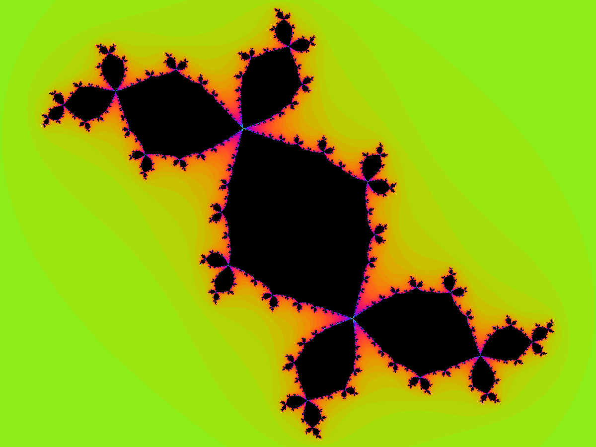
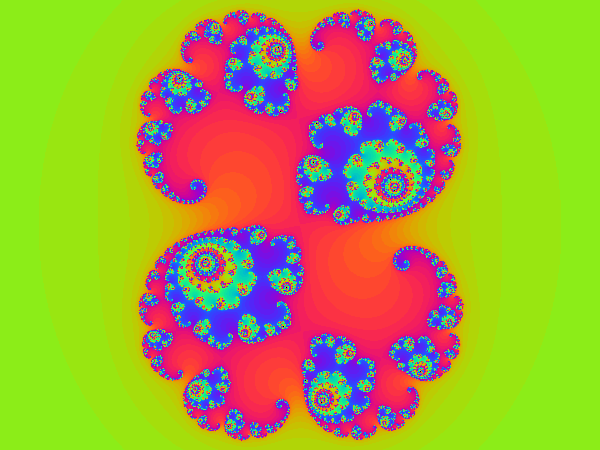

# Ensembles de Julia en C

Générateur d'images d'ensembles de Julia écrit en C, sans bibliothèque externe pour le calcul ni pour le dessin. Le projet contient deux programmes :

- `julia` calcule une image pour une valeur donnée de `c` et l'écrit au format PPM.
- `batch` lit un fichier de paramètres, lance `julia` pour chaque ligne, convertit les images en PNG et les range dans deux dossiers.



*Ensemble de Julia pour c = -0,123 + 0,745i (« lapin de Douady »).*

## Les fractales en bref

Une fractale est une figure dont la structure se répète à toutes les échelles : quand on zoome sur un détail, on retrouve des formes qui ressemblent à l'ensemble de départ. Les côtes, les nuages ou les fougères en sont des approximations naturelles. Les fractales de ce projet, elles, sont définies par une formule mathématique très courte, répétée un grand nombre de fois.

## Les ensembles de Julia

On travaille avec des nombres complexes, de la forme `z = a + bi`, que l'on représente comme des points d'un plan : `a` est l'abscisse et `b` l'ordonnée.

On fixe un nombre complexe `c`. Pour chaque point de départ `z0` du plan, on calcule la suite :

$$z_{n+1} = z_n^2 + c$$

Cette suite se comporte de deux façons :

- soit elle reste bornée : les valeurs ne s'éloignent jamais très loin de l'origine ;
- soit elle diverge : les valeurs grandissent sans limite.

L'ensemble de Julia rempli est l'ensemble des points `z0` pour lesquels la suite reste bornée. L'ensemble de Julia proprement dit est la frontière de cette zone, et c'est elle qui a une forme fractale. Changer `c` change complètement la forme obtenue.

### Comment le programme dessine l'image

1. Chaque pixel de l'image correspond à un point `z0` du plan complexe.
2. On calcule la suite jusqu'à ce que `|z| > 2` ou que le nombre maximal d'itérations soit atteint. Pour `|c| <= 2`, dès que `|z| > 2`, la suite diverge.
3. Si le maximum est atteint sans divergence, le pixel est noir : le point appartient à l'ensemble.
4. Sinon, le pixel est colorié selon le nombre d'itérations nécessaires pour sortir. C'est ce qui produit les bandes de couleur autour de la forme.



*c = 0,285 + 0,01i.*

## Arborescence

```
.
├── makefile              compile les deux programmes
├── jobs.txt              exemple de fichier de paramètres pour batch
├── bin/                  exécutables générés (julia, batch)
├── julia/
│   ├── makefile
│   ├── include/julia.h   types et prototypes
│   ├── src/julia.c       calcul, couleurs, écriture PPM, lecture des arguments
│   ├── src/main.c        programme en ligne de commande
│   └── tests/tests.c     tests
├── batch/
│   ├── makefile
│   ├── include/batch.h
│   ├── src/batch.c       lecture du fichier de paramètres, lancement des processus
│   ├── src/main_batch.c  programme en ligne de commande
│   └── tests/tests_batch.c
└── docs/images/          images utilisées dans ce README
```

## Prérequis

- Un compilateur C (`gcc`) et `make`.
- ImageMagick pour la commande `convert`, utilisée par `batch` pour passer du PPM au PNG.
- Un système POSIX (Linux), car `batch` utilise `fork` et `execvp`.

Installation :

```
# Debian / Ubuntu
sudo apt install build-essential imagemagick
```

## Compilation

Depuis le dossier principal :

```
make
```

Les exécutables `julia` et `batch` sont placés dans `bin/`.

## Utilisation

### julia

```
./bin/julia c_re c_im [largeur hauteur max_iter sortie.ppm]
```

- `c_re` et `c_im` sont la partie réelle et la partie imaginaire de `c`. Ils sont obligatoires.
- Valeurs par défaut des autres paramètres : `800 600 200 julia.ppm`.
- La zone affichée va de -1,5 à 1,5 en abscisse. L'ordonnée est ajustée selon les proportions de l'image pour que les pixels restent carrés.
- En cas d'argument absent ou invalide, le programme affiche un message d'usage et renvoie le code 1.

Exemples :

```
./bin/julia -0.123 0.745 800 600 200 lapin.ppm
convert lapin.ppm lapin.png
```

### batch

```
./bin/batch jobs.txt [dossier_ppm dossier_png]
```

Les dossiers par défaut sont `ppm` et `png`. Pour chaque ligne valide du fichier, `batch` lance `julia`, puis `convert`, et range les fichiers dans les deux dossiers. Une ligne invalide est signalée sur la sortie d'erreur et n'arrête pas le traitement des suivantes. À la fin, le programme affiche un bilan et renvoie 0 si tout a réussi, 1 sinon.

Exemples :

```
./bin/batch jobs.txt PPM PNG
```

Format du fichier de paramètres, une image par ligne :

```
# nom c_re c_im largeur hauteur max_iter
lapin -0.123 0.745 600 450 200
spirale 0.285 0.01 600 450 300
siegel -0.390541 -0.586788 600 450 400
```

- Les lignes vides et celles qui commencent par `#` sont ignorées.
- Le nom ne contient que des lettres, des chiffres, `_` et `-`. Il sert de nom de fichier, donc il doit être unique.
- La largeur et la hauteur vont de 2 à 10000, `max_iter` de 1 à 100000.